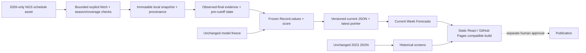

# Architecture — current forecasts and historical analysis

The current adapter is separate from the historical loader, feature-builder guards, training and holdout protocol. It imports only frozen feature definitions/state formulas and deterministic scoring; it never imports training or relabels protected seasons. Current acquisition whitelists a single current-season URL. No all-season fallback exists. Every raw row must match the requested non-protected season before scores are normalized; only REG enters state. Bounded requests, schema/coverage validation and snapshot checksums form the input trust boundary.

Source FINAL is evidence of completion by observation time, not an exact end timestamp. Immutable earlier snapshots establish first-observed bounds only for identical result/date/team records. Missing prior records, uncertain completion, delayed results or unknown historical dates cause affected forecasts to be unavailable. The cutoff is min(decision time, target Eastern midnight); state also excludes target-day results. Rescheduled rows retain a stable source game-key ID; changed schedule fingerprints produce new versions and warnings. Stale snapshots and kickoff-passed games are visibly invalidated in the browser.

Versioned JSON and an atomic latest pointer are separate from the frozen historical demo. Failed refreshes leave the last good version intact, with age shown; they never manufacture current data. The browser verifies content hash, season, time ordering, exact frozen model and feature arithmetic before displaying probabilities. Forecast records carry no target outcomes. All rendering remains static, uses text team identifiers and requires no keys or live browser data-provider calls. Current and historical load/error states are independent.

A disabled refresh workflow may later run bounded Python scoring and upload one candidate artifact using read-only repository permissions. It has no cron or deployment step. Manual review/promotion remains necessary; $0 depends on account/runner quotas. Existing Pages deployment remains disabled. No personal-site integration is authorized.
