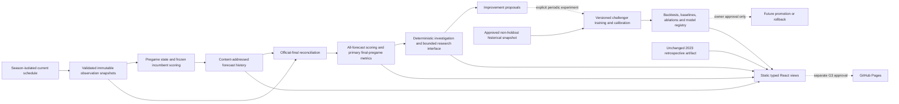

# Architecture — Fourth Down prediction and learning lifecycle

**V2 research addition (2026-10-25):** `ml/v2_data.py` acquires only fourteen approved season-specific PBP files (2010–2023); `v2_features.py` joins hash-verified schedule/efficiency snapshots and stores adjustments from opponents' earlier-date ratings. `v2_experiment.py` runs six fixed train/calibrate/diagnostic folds with the same calibrated four-feature comparator. JSON models, game predictions, feature snapshots, coverage, paired uncertainty and provenance live solely in `research/v2/`. No production registry, static pointer, refresh or frontend imports these modules. `v2_shadow.py` supplies an isolated immutable paired-replay ledger and dual-model outcome scoring; prospective collection remains disabled, including 2026's protected prior-year dependency. Corrected historical inputs cannot be relabeled as prospective evidence. Existing operational architecture below is unchanged.

## Trust and temporal boundaries
The frozen historical loader/features/training/forecast files, model manifest, coefficients, preprocessing and evidence remain untouched. The current adapter reuses Record.values and score, but acquisition selects a single >=2026 current-season asset before normalization. There is no all-season fallback. Release metadata is not outcome acquisition. Local raw bytes, normalized snapshots and artifacts have content hashes. No protected 2024–2025 data is used even for a prior-season challenger input.

The incumbent uses the earlier of actual decision time and target-date Eastern midnight, with strictly earlier-date games and finals observed strictly before cutoff. No guessed completion time or backdated data availability. Corrections require new observed evidence. Forecast history includes actual recorded/generation times, original kickoff/date and schedule fingerprint. Reconciliation verifies identity, timing and the official final status against original records; it cannot turn a historical replay or post-kickoff computation into a prospective forecast. UI freshness expiry is distinct from historical evaluation eligibility. Selection/scoring policy is fixed in LIFECYCLE_PROTOCOL.md before reconciliation.

## Artifacts and components
- **Current inputs/inference:** ml/current_source.py and ml/current.py; bounded explicit acquisition, per-season normalized evidence, same-season state, unchanged frozen-model predictions. Existing web/public/data/current versions remain immutable.
- **Refresh orchestration:** ml/refresh.py; explicit local actual-time execution, bounded failures, shared snapshot for generation/reconciliation, retained observation history and schedule-relative planning. No model fitting or protected acquisition.
- **Lifecycle:** ml/lifecycle.py; verified forecast catalog, game statuses, candidate/final pregame selection, result revisions, per-snapshot and primary metrics, calibration/baseline summaries, deterministic evidence findings. Versioned operations artifacts retain prior assessments.
- **Research/learning:** separately versioned challenger pipeline and registry. Predeclared protocol, fixed train/calibration/validation windows, feature-domain provenance, reproducible coefficients and measured ablations. Approval status remains candidate/research; no automatic promotion path.
- **Static application:** independent validated current/operations/research loads, separate historical replay. Upcoming, intelligence, history, model and postgame screens consume actual artifacts; missing context and zero observations stay explicit. Original CSS text team identifiers and license notices remain.

## Failure and approval boundaries
A source failure leaves the last good forecasts intact and returns a failed local refresh; age is never reset without a real new generation. Missing inputs produce unavailable probabilities, not imputed news/weather/injury facts. Schedule-aware planning includes uncommon kickoff times and reconciliation after verified finals; scheduler delays are handled with actual run time, never intended-run timestamps. Concurrent local runs must not corrupt pointers. A fresh runner's missing observation history is explicit, not silently reconstructed.

Forecast and result artifacts are static and immutable; small latest pointers are replaceable indexes. Hashes establish identity/integrity, not independent source truth. Data providers remain external trust boundaries. Bounded agent outputs must cite timestamped evidence, separate fact/hypothesis/defect and cannot edit probabilities or promote a model. Deterministic analysis is the zero-API-cost default.

GitHub Actions refresh preparation remains disabled, read-only and bounded. No cron, paid inference, database or persistent backend is enabled. Publication, recurring public execution, account/billing changes, holdout evaluation and model promotion are separate human approvals. Existing personal-site files are outside scope. $0 infrastructure is an objective contingent on public-runner/Pages eligibility and account/storage controls, not a universal cost guarantee.
