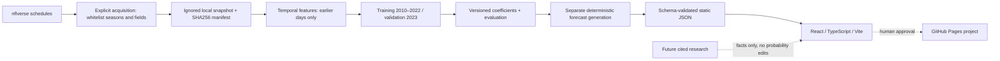

# Architecture

Training, forecast generation, and rendering are separate commands/components. Source data is untrusted: whitelist columns; reject duplicate IDs, incomplete outcomes, invalid dates and protected seasons. Fitting statistics use training only. Generated artifacts carry source/model/feature identifiers and timestamps. Browser validates the contract before rendering; no raw HTML or external requests besides its own static JSON. Model explanations sum coefficient × feature contributions in log-odds; they are not causal effects.

No database or application server. Raw data and model intermediates are ignored. The checksummed compact 2023 demo is tracked for clean-checkout builds; public redistribution still requires G3 approval. The additive holdout protocol and exposure record are distinct from the unchanged candidate artifacts. CI is manual-only, bounded and does not train/download data or deploy. Deployment workflow is a disabled template. Hash routes support refresh. Vite base is configurable. Research is a documented, unimplemented boundary.
